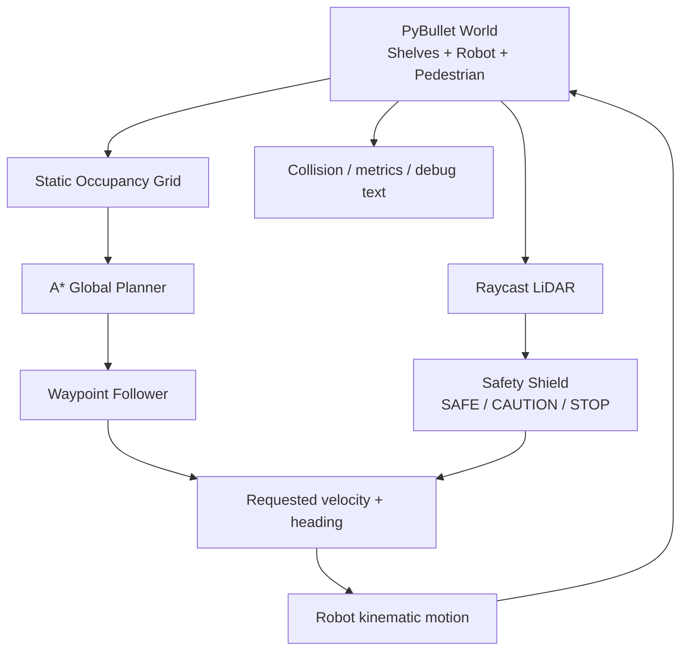

# SafeBot AI — Explainable Safety Shield for Autonomous Mobile Robots

> **Vin Robotics Hackathon | MVP trong 120 phút | Python + PyBullet | CPU-only**
>
> **Nhiệm vụ dành cho coding agent:** Đọc toàn bộ README, triển khai một demo **chạy được thật**, kiểm thử bằng các lệnh trong mục [Definition of Done](#12-definition-of-done--nghiệm-thu). Ưu tiên tuyệt đối: **hoàn thành, ổn định, có khả năng trình diễn**; không tự ý mở rộng phạm vi.

## 0. TL;DR — Agent phải xây dựng gì?

Xây dựng ứng dụng mô phỏng **1 robot di động (AMR)** vận chuyển từ **START** đến **GOAL** trong kho 3D PyBullet.

1. Robot dùng **A\*** tìm đường qua các kệ hàng cố định (static obstacles).
2. Robot di chuyển theo waypoint bằng **kinematic controller** đơn giản.
3. **LiDAR giả lập** bằng `pybullet.rayTestBatch()` phát hiện người phía trước.
4. **Safety Shield** điều chỉnh tốc độ theo ba trạng thái **SAFE → CAUTION → STOP**, rồi tự đi tiếp sau khi đường thông thoáng.
5. Chạy được hai chế độ **`safe`** (bật shield) và **`baseline`** (tắt shield) trên **cùng một kịch bản người đi ngang**, ghi nhận số sự kiện va chạm, thời gian, khoảng cách tối thiểu và kết quả giao hàng.
6. Có **GUI** để trình diễn và **headless** để agent chạy test không cần màn hình.

**Thành công tối thiểu:** `safe` đến đích, không va chạm người; `baseline` trong cùng kịch bản có thể xảy ra va chạm được ghi nhận chính xác. Agent phải điều chỉnh kịch bản để kết quả so sánh có thể tái lập, **không được hard-code/chế số liệu**.

**Không làm trong MVP:** deep learning, train model, SLAM, camera object detection, ROS/ROS 2, nhiều robot, cánh tay gắp, robot physics với bánh xe thực, UI web, LLM/Multi-Agent, học tăng cường, dynamic replanning. Đây là một hệ thống điều hướng **rule-based** có lớp bảo vệ an toàn; tên SafeBot AI là tên dự án, **không tuyên bố có mô hình ML nếu chưa tích hợp**.

---

## 1. Bài toán và giá trị của demo

**Bối cảnh:** Một robot AMR giao hàng trong kho. Thuật toán đường đi giải quyết các **vật cản tĩnh** (kệ hàng), nhưng đường đi có thể bị **con người bất ngờ cắt ngang**.

**Ý tưởng:** Tách riêng hai nhiệm vụ:

- **Global planner (A\*):** “Muốn tới đích thì đi đường nào?”
- **Safety Shield:** “Ở thời điểm này có an toàn để thực thi lệnh di chuyển không?”

**Điểm khác biệt khi trình diễn:** Một tình huống duy nhất được chạy với/không có Safety Shield. SafeBot đưa ra quyết định **có giải thích** (`Human detected`, `Safety distance violated`, `Path cleared`) và tự tiếp tục nhiệm vụ. Cho ban giám khảo thấy **trade-off giữa an toàn và thời gian giao hàng**.

**Lưu ý trung thực khoa học:** Đây là demo *reactive safety* theo khoảng cách, không phải hệ thống chứng nhận an toàn công nghiệp, không phải mô hình dự đoán hành vi người hay tính TTC.

---

## 2. Tech stack và yêu cầu môi trường

| Hạng mục | Lựa chọn | Lý do |
|---|---|---|
| Language | Python **3.10+** | Viết và sửa nhanh |
| Simulator | **PyBullet** | 3D, raycast, GUI và DIRECT/headless |
| Math | **NumPy** | Vector 2D, khoảng cách |
| Planning | A\* tự cài bằng `heapq` | Không cần thư viện robotics lớn |
| Visualization | PyBullet GUI + `addUserDebugLine`, `addUserDebugText` | Không phải viết dashboard riêng |
| Test/report | `argparse`, `json`, `unittest` (stdlib) | Không phụ thuộc framework test |

**Cấu hình khuyến nghị:** CPU i3/i5 hoặc tương đương, RAM 4 GB trở lên; **không cần CUDA/NVIDIA**. Có thể chạy `--headless` trên VPS không có GPU. Cửa sổ GUI cần desktop session/OpenGL.

### Cài đặt (Ubuntu/Linux)

```bash
python3 -m venv .venv
source .venv/bin/activate
python -m pip install --upgrade pip
python -m pip install pybullet numpy
```

**Nếu gặp lỗi GUI trên Linux:** kiểm tra biến môi trường `DISPLAY`, chạy trong desktop session; thử `--headless` để phân biệt lỗi hiển thị và lỗi thuật toán. Không dành nhiều thời gian sửa OpenGL trên VPS.

### Cấu trúc thư mục mong muốn

```text
safebot-ai/
├── README.md                 # Tài liệu này
├── main.py                   # Toàn bộ demo, chia hàm/class dễ đọc
├── requirements.txt          # pybullet, numpy
├── tests/
│   └── test_planner.py       # Có thể bổ sung sau khi demo chạy
└── results/                  # Tạo tự động khi chạy (JSON)
    ├── safe.json
    └── baseline.json
```

**Ưu tiên một file `main.py` chạy được** hơn cấu trúc nhiều package chưa ghép xong. Không cần tải model, texture hoặc asset ngoài mạng. Dùng `createCollisionShape`, `createVisualShape`, `createMultiBody` để sinh robot/kệ/người từ hình học cơ bản. Nếu dùng `plane.urdf`, nhớ `pybullet_data` và `setAdditionalSearchPath()`; cách đơn giản hơn là tự tạo sàn bằng một box.

---

## 3. Phạm vi MVP và cấu hình mặc định

### 3.1. Bản đồ kho

Hệ tọa độ **XY** phẳng, trục **Z** hướng lên, đơn vị **mét**.

| Thành phần | Giá trị ban đầu |
|---|---|
| Diện tích | `8.0 x 8.0 m` |
| Grid A\* | `resolution = 0.25 m/cell`, tương đương 32 x 32 ô |
| START | `(0.75, 0.75)` |
| GOAL | `(7.25, 7.00)` |
| Bán kính robot | `0.25 m` |
| Bán kính người | `0.22 m` |
| Khoảng đệm kệ hàng | `0.15 m`, ngoài bán kính robot |
| Trần thời gian | `90 s` theo **simulation time** (có thể tăng nếu cần) |
| Physics fixed timestep | `1 / 120 s` |

Gợi ý **3 kệ hàng cố định** (axis-aligned rectangles); tọa độ là **tâm**, kích thước là **nửa chiều rộng / nửa chiều cao trên mặt XY**:

| Kệ | Tâm `(x, y)` | Nửa kích thước `(hx, hy)` |
|---|---|---|
| A | `(2.40, 2.30)` | `(0.40, 0.95)` |
| B | `(4.00, 4.30)` | `(0.50, 0.85)` |
| C | `(5.80, 2.90)` | `(0.40, 1.10)` |

Đây là **tọa độ gợi ý**. Agent được điều chỉnh nhỏ nếu pathfinding không có đường hoặc hành lang không đủ rộng, nhưng phải duy trì cùng một bản đồ cho cả hai chế độ. Không đặt kệ chắn trực tiếp START/GOAL.

### 3.2. Robot và người mô phỏng

- Robot: **cylinder màu xanh** hoặc box màu xanh, z đủ cao để nhìn rõ, collision shape bán kính `0.25 m`.
- Người: **cylinder/capsule màu cam**, bán kính mặt bằng `0.22 m`, di chuyển theo kịch bản lập trình sẵn, **không cần hình người 3D**.
- Kệ: box màu xám; điểm START xanh dương; GOAL xanh lá.
- Camera: mặc định **góc nhìn từ trên cao hơi nghiêng** bao quát toàn kho (`resetDebugVisualizerCamera`).
- Có vẽ tuyến waypoint bằng đường màu xanh; biểu diễn tia LiDAR bằng debug lines **nếu không làm giảm hiệu năng**.

**Quan trọng:** Robot dùng **kinematic motion** (`resetBasePositionAndOrientation` sau mỗi bước tính toán), không bắt buộc có hai bánh xe/động lực học cơ khí. Ghi rõ trong README/during pitch để tránh nhầm với điều khiển robot thực.

---

## 4. Kiến trúc và luồng dữ liệu



**Quy tắc:** A\* xử lý kệ tĩnh. Người là vật cản **động**, **không được đưa vào occupancy grid cố định**. Safety Shield xử lý người bằng giảm tốc/dừng/chạy tiếp, **không yêu cầu tìm đường vòng người**.

### 4.1. A\* Global Planner

**Input:** start, goal, các AABB của kệ, grid 32x32.

**Output:** danh sách các tâm ô/waypoint từ START đến GOAL.

Yêu cầu thuật toán:

1. Chuyển tọa độ `(x, y)` sang `(row, col)` và ngược lại, kiểm tra giới hạn thế giới.
2. Đánh dấu ô bị chiếm nếu tâm ô nằm trong **kệ đã inflate** bởi `r_robot + margin = 0.40 m` (có thể bảo thủ hơn bằng kiểm tra box-cell intersection).
3. Dùng A\* với hàng đợi ưu tiên `heapq`, `g_score`, `came_from`, closed set.
4. Di chuyển **8 hướng**, chi phí thẳng = `1`, chéo = `sqrt(2)`, heuristic **Euclidean/Octile**.
5. **Không cắt góc:** bước chéo chỉ hợp lệ nếu cả hai ô trực giao kề bên không bị chặn.
6. Start/goal ngoài bản đồ hoặc bị chắn → thông báo lỗi dễ hiểu, **không được vòng lặp vô hạn**.
7. Khi đạt waypoint trong bán kính `<= 0.13 m`, chuyển waypoint tiếp theo. Khi cách GOAL `<= 0.25 m`, kết thúc nhiệm vụ.

**Không cần** path smoothing, spline, DWA, MPC, SLAM trong MVP. Nếu waypoint zig-zag khó nhìn, có thể vẽ đường đi rõ hơn, nhưng tránh tối ưu quỹ đạo làm robot cắt qua kệ.

### 4.2. Kinematic waypoint follower

Trên mặt phẳng XY:

```python
vec = target_waypoint - robot_xy
unit = vec / max(np.linalg.norm(vec), 1e-9)
next_xy = robot_xy + unit * min(speed * dt, np.linalg.norm(vec))
heading_yaw = math.atan2(unit[1], unit[0])
```

Robot chỉ đổi **x, y, yaw**, giữ **z** không đổi. **Clamp** vị trí trong biên hợp lệ của kho. Tại `STOP`, `speed=0` và **không làm trôi robot**. Sau khi robot tới GOAL, ghi `success=True` và thoát sạch.

Không bắt buộc mô phỏng gia tốc/động lực học. Nếu thêm tăng/giảm tốc, chỉ làm **sau** khi toàn bộ MVP đã chạy ổn.

### 4.3. LiDAR mô phỏng bằng PyBullet

- Dùng `p.rayTestBatch(rayFromPositions, rayToPositions)`.
- **41 tia** trong khoảng **-90° đến +90°** tương đối với hướng đi hiện tại; độ dài tia tối đa `3.0 m`.
- Đặt cao độ quét **z = 0.35 m** để cắt thân người và thân kệ, tránh mặt sàn.
- Tia phải **bắt đầu ngoài bề mặt robot** (ví dụ `robot_center + 0.28 * ray_direction`) để tránh ray chạm chính robot; bỏ hit có `bodyUniqueId == robot_id` nếu gặp.
- Dùng `hitObjectUniqueId` để phân biệt **person_id** với shelves; có thể biểu diễn khoảng cách từ điểm bắt đầu tia tới `hitPosition` hoặc `hitFraction * ray_length`.
- Lấy **khoảng cách tới bề mặt người gần nhất** trong vùng nhìn phía trước. Nếu không thấy người, trả `float('inf')`.
- Scan ở mỗi bước hoặc mỗi 2–4 bước vật lý; với 41 tia và một robot, mức này phù hợp demo CPU.

**MVP chỉ tránh người bằng Safety Shield.** Kệ hàng đã được A\* tránh trên bản đồ. Nếu mất line-of-sight vì kệ che khuất, raycast không được phép “nhìn xuyên” kệ.

### 4.4. Safety Shield (phần chính của sản phẩm)

Thông số ban đầu (đơn vị là **khoảng cách ray từ gần bề mặt robot đến bề mặt người**, không phải khoảng cách tâm-tâm):

| Khoảng cách LiDAR đến người | Trạng thái | Tốc độ tối đa |
|---|---|---|
| `d >= 1.60 m` hoặc chưa phát hiện | `SAFE` | `0.65 m/s` |
| `0.80 m <= d < 1.60 m` | `CAUTION` | `0.25 m/s` |
| `d < 0.80 m` | `STOP` | `0.00 m/s` |

Gợi ý code:

```python
def safety_shield(distance_to_person_m: float) -> tuple[str, float, str]:
    if distance_to_person_m < 0.80:
        return "STOP", 0.0, "Safety distance violated"
    if distance_to_person_m < 1.60:
        return "CAUTION", 0.25, "Human detected ahead"
    return "SAFE", 0.65, "Path clear"
```

**Baseline** nhận cùng `requested_speed = 0.65 m/s` từ waypoint follower nhưng **bỏ qua Safety Shield**; kệ vẫn được A\* tránh trong cả hai chế độ.

Để tránh nhấp nháy trạng thái khi người đứng sát ngưỡng, agent **có thể** thêm hysteresis `0.10 m` lúc thoát khỏi CAUTION/STOP, nhưng chỉ sau khi demo chạy ổn. Không bắt buộc.

Mỗi khi trạng thái đổi, in log rõ ràng:

```text
[12.45s] SAFE -> CAUTION | pedestrian=1.43m | Human detected ahead
[16.02s] CAUTION -> STOP | pedestrian=0.78m | Safety distance violated
[23.70s] STOP -> SAFE | pedestrian=inf | Path clear
```

Các số trên **chỉ là ví dụ log**, không phải kết quả thực tế.

---

## 5. Kịch bản người đi ngang — phải tái lập được

**Đây là điểm mấu chốt để chắc chắn demo thành công.** Không dùng random spawn, không để người di chuyển tự do hoặc chỉ spawn theo thời gian thực của máy.

### 5.1. Chọn điểm cắt ngang

- Sau khi A\* tìm ra đường, chọn một waypoint khoảng **60–70% tổng chiều dài đường đi** làm **crossing point**.
- Nên chọn waypoint có vùng trống xung quanh (ít nhất `~0.7–1.0 m`) để người có thể bước từ ngoài đường vào giữa đường mà không đi xuyên kệ. Nếu vị trí đó hẹp, chọn waypoint lân cận đủ trống; **tính deterministically**.
- Hướng đi bộ của người là hướng **vuông góc** với tiếp tuyến tuyến đường ở crossing point. Nếu khó xử lý, chọn một hướng offset `(0, ±0.9m)` không đè lên kệ.
- Nếu đoạn đường gấp khúc, ưu tiên một đoạn tương đối thẳng; nếu logic chọn vị trí phức tạp, **hard-code crossing point phù hợp với bản đồ cố định sau khi quan sát A\***. Đây là demo kho cố định nên được phép cố định scenario.

### 5.2. Timeline của pedestrian

Kích hoạt kịch bản khi robot còn cách **crossing point khoảng 2.0–2.2 m** dọc theo quỹ đạo (sai số chấp nhận được khi dùng Euclidean distance ở đoạn thẳng).

1. **APPROACH** (`~1 s`): người đi từ bên cạnh vào đúng crossing point.
2. **BLOCKING** (`~8–10 s`): người đứng ở giao điểm đủ lâu để Baseline đi tới và có cơ hội va chạm; SafeBot phải giảm tốc rồi dừng.
3. **LEAVING** (`~1–2 s`): người tiếp tục sang phía bên kia, ra khỏi đường robot.
4. **CLEARED**: robot SafeBot tự đi tiếp tới GOAL.

Khi kịch bản đã kích hoạt, chuyển động pedestrian dựa vào **simulation time kể từ lúc kích hoạt**, không dựa vào `time.time()`, FPS GUI hoặc việc SafeBot đã dừng. Dùng **chính xác cùng logic kích hoạt và di chuyển** cho cả `safe` và `baseline`.

**Ràng buộc thực tế:** Với tốc độ thường `0.65 m/s`, robot Baseline đi 2 m trong khoảng 3.1 s; người chặn 8–10 s đủ để có giao nhau. SafeBot trong CAUTION đi `0.25 m/s`, vì vậy có thời gian giảm tốc và đi tới vùng STOP trước khi người rời đi.

Nếu 2 mode không cho thấy khác biệt ở lần test đầu:

- Điều chỉnh **vị trí crossing point**, thời điểm trigger hoặc **blocking duration**.
- Giữ lại cùng cấu hình scenario giữa 2 lần chạy.
- Không làm giả số va chạm hay bắt Baseline báo va chạm bằng một điều kiện không dựa trên hình học.

### 5.3. Tránh va chạm với người thế nào?

SafeBot **dừng để nhường đường**. Không yêu cầu vòng qua người hoặc tính lại A\* theo môi trường động trong v1. Điều này vừa hợp lý cho robot vận chuyển trong hành lang hẹp, vừa chắc chắn hoàn thành 2 giờ.

---

## 6. Đo lường và xuất kết quả

### 6.1. Metric bắt buộc

| Metric | Định nghĩa chuẩn |
|---|---|
| `mission_success` | `true` khi tâm robot cách GOAL `<= 0.25 m` trước timeout |
| `collision_events` | Số **lần bắt đầu va chạm** với người, không phải số frame đang chồng hình học |
| `min_clearance_m` | Min khoảng cách **bề mặt robot–người** (center distance trừ tổng bán kính); có thể âm khi xuyên nhau |
| `completion_time_s` | Thời gian mô phỏng tới đích, hoặc thời điểm hết hạn nếu fail |
| `stop_duration_s` | Tổng thời gian robot ở trạng thái `STOP` |
| `state_transitions` | Số lần đổi trạng thái (cho safe) |

Để tính collision **ổn định khi di chuyển kinematic bằng `resetBasePositionAndOrientation`**, đừng chỉ phụ thuộc `getContactPoints()`; các cặp body được reset vị trí có thể không phản ánh contact như một robot dynamic. Dùng kiểm tra hình học trên mặt XY:

```python
center_distance = float(np.linalg.norm(robot_xy - pedestrian_xy))
clearance = center_distance - (ROBOT_RADIUS + HUMAN_RADIUS)
colliding_now = clearance <= 0.0
if colliding_now and not colliding_previous_frame:
    collision_events += 1
colliding_previous_frame = colliding_now
```

Đây là collision kiểm tra bằng **hình tròn xấp xỉ mặt bằng**; phù hợp với cylinder robot và pedestrian. Nếu dùng box cho robot phải thay bằng kiểm tra hình học tương ứng. Có thể kiểm thêm va chạm với kệ bằng khoảng cách **circle–AABB** sau khi robot cập nhật vị trí.

### 6.2. File JSON bắt buộc

Tự tạo thư mục `results/` rồi ghi `results/<mode>.json`, **giá trị phải tính từ simulation thực**:

```json
{
  "mode": "safe",
  "seed": 42,
  "mission_success": true,
  "collision_events": 0,
  "min_clearance_m": 0.37,
  "completion_time_s": 28.6,
  "stop_duration_s": 5.1,
  "state_transitions": 3,
  "path_length_m": 9.2,
  "failure_reason": null
}
```

**Các số trong JSON trên chỉ là ví dụ cấu trúc, tuyệt đối không copy làm output thật.** `path_length_m` có thể là tổng quãng đường thực tế đã di chuyển, hãy định nghĩa rõ nhất quán trong code.

Cuối mỗi lần chạy, in summary dễ đọc và kết thúc process. Không để GUI treo sau khi đạt GOAL; có thể giữ khung hình 2–3 giây nếu `--gui`, rồi `p.disconnect()`.

---

## 7. CLI/API contract — bắt buộc hỗ trợ

```bash
# GUI: bản demo dành cho ban giám khảo
python main.py --mode safe
python main.py --mode baseline

# Headless: bắt buộc agent tự kiểm tra được
python main.py --mode safe --headless --seed 42 --max-seconds 90
python main.py --mode baseline --headless --seed 42 --max-seconds 90

# Hiển thị tùy chọn
python main.py --mode safe --show-lidar
python main.py --help
```

### Tham số

| CLI | Default | Chức năng |
|---|---|---|
| `--mode {safe,baseline}` | `safe` | Chọn chế độ |
| `--headless` | off | Sử dụng `p.DIRECT` thay `p.GUI` |
| `--seed INT` | `42` | Scenario lặp lại được |
| `--max-seconds FLOAT` | `90` | Timeout theo simulation time |
| `--show-lidar` | off | Vẽ ray debug nếu ở GUI |
| `--speedup FLOAT` | `1.0` | **Tùy chọn**, điều chỉnh tốc độ hiển thị GUI, không đổi dt physics |

**Quy tắc headless:** `p.connect(p.DIRECT)`, không `sleep`, không tạo cửa sổ, không phụ thuộc `DISPLAY`; vẫn phải chạy toàn bộ simulation, xuất metrics và `disconnect()`.

**Exit code:** `0` khi chương trình chạy hết kịch bản không lỗi kỹ thuật (kể cả baseline có collision đã được đo); **khác 0** khi crash, fail lập kế hoạch, timeout bất thường hoặc lỗi cài đặt. `mission_success` luôn đọc từ JSON, không suy diễn đơn thuần từ exit code.

### Cấu trúc hàm/class tham khảo trong `main.py`

```python
# Constants / dataclasses
# create_world(client) -> WorldState
# build_occupancy_grid(world) -> np.ndarray
# astar(grid, start, goal) -> list[tuple[float, float]]
# choose_crossing_point(path, world) -> CrossingScenario
# update_pedestrian(scenario, robot, sim_time, dt) -> None
# raycast_lidar(robot, person_id, obstacles) -> float
# safety_shield(distance_to_person_m) -> (state, max_speed, reason)
# follow_waypoints(robot, path, speed, dt) -> None
# update_collision_metrics(...) -> None
# draw_debug_info(...) -> None
# save_metrics(results_path, metrics) -> None
# run_simulation(args) -> dict
# main() -> None
```

Không nhất thiết tạo class phức tạp. **Dễ debug quan trọng hơn thiết kế OOP hoàn hảo.**

### Chu trình simulation được yêu cầu

```python
physics_dt = 1.0 / 120.0
sim_time = 0.0
while sim_time < args.max_seconds and not goal_reached:
    update_pedestrian(...)  # scripted, deterministic
    distance = raycast_lidar(...)  # front-facing ray hits

    if args.mode == "safe":
        state, speed, reason = safety_shield(distance)
    else:
        state, speed, reason = "BASELINE", 0.65, "Shield disabled"

    follow_waypoints(..., speed=speed, dt=physics_dt)
    update_collision_metrics(...)
    update_debug_overlay_if_gui(...)
    p.stepSimulation()
    sim_time += physics_dt

    # GUI only: sleep/refresh at a manageable rate

save_metrics(...)
p.disconnect()
```

Đây là **pseudocode kiến trúc**, coding agent phải viết mã đầy đủ, xử lý các tham số và trạng thái hợp lệ. Không sao chép các dấu `...` làm stub trong sản phẩm cuối.

---

## 8. Giao diện demo 3D — tối giản nhưng dễ hiểu

**Màn hình PyBullet nên có:**

- Sàn xám nhạt, ba kệ màu xám đậm, robot màu xanh, người màu cam.
- Vạch Start, Goal và đường đi A\*.
- Dòng text cập nhật: `MODE: SAFE`, `STATE: CAUTION`, `HUMAN DIST: 1.2m`, `TIME: 14.2s`.
- Đổi màu robot hoặc vòng sáng theo trạng thái: **xanh = SAFE**, **vàng = CAUTION**, **đỏ = STOP**; hoặc chỉ đổi màu dòng trạng thái nếu chỉnh màu object quá rủi ro.
- Khi đến đích: `MISSION COMPLETED` và summary.

**Mẹo PyBullet:** dùng `addUserDebugText()` với `replaceItemUniqueId` để **cập nhật nội dung** thay vì liên tục tạo text mới mỗi frame. Tương tự, giới hạn số line debug và xóa/cập nhật để không bị tụt FPS. UI không cần fancy — **sự kiện robot dừng đúng lúc** mới là điểm chính.

---

## 9. Phân đoạn demo live 45–60 giây

**Cảnh 1 — Navigation:** chạy `python main.py --mode safe`; robot từ Start theo waypoint luồn qua kệ. Giới thiệu A\*.

**Cảnh 2 — Pedestrian crossing:** người bước ra giữa đường. LiDAR thấy người; state `SAFE → CAUTION → STOP`. Robot đứng yên, log hiện **vì sao** dừng.

**Cảnh 3 — Recovery:** người rời đường, state trở lại SAFE, robot tự chạy đến Goal. Hiện kết quả mission.

**Cảnh 4 — Baseline:** chạy `python main.py --mode baseline`, cùng kịch bản, robot **không áp dụng Safety Shield**. Quan sát nếu có collision và so sánh `results/baseline.json` với `results/safe.json`.

> **Nếu chạy full world quá lâu:** tăng tốc hiển thị bằng `--speedup` (nếu đã triển khai đúng) hoặc dùng chế độ headless để lấy metrics nhanh. Không sửa dữ liệu đầu ra cho đẹp.

### Pitch 30–45 giây

> “Trong kho hàng, việc tìm được đường ngắn nhất là chưa đủ: robot còn phải biết khi nào không nên đi tiếp. SafeBot sử dụng A\* để điều hướng giữa các kệ hàng và một Safety Shield độc lập dựa trên LiDAR mô phỏng để giảm tốc hoặc dừng khi có người cắt ngang. Điểm quan trọng là robot giải thích được quyết định của mình và tự tiếp tục khi an toàn. Chúng em chạy cùng một tình huống có và không có Safety Shield, rồi đo số lần va chạm, thời gian hoàn thành và khoảng cách an toàn tối thiểu. Đây là bản demo an toàn phản ứng trong môi trường mô phỏng, tạo nền tảng để mở rộng sang robot thực.”

---

## 10. Timeline cứng 120 phút dành cho coding agent

| Mốc | Việc cần hoàn thành | Checkpoint quan sát được |
|---|---|---|
| **00–20′** | Cài deps; PyBullet GUI/DIRECT; floor, shelves, robot, camera | Render được kho 3D và chạy được headless |
| **20–50′** | Occupancy grid, A\*, robot đi theo waypoint | Robot tới Goal, tránh kệ |
| **50–80′** | Person scenario, raycast, Safety Shield, text trạng thái | SafeBot giảm tốc/dừng rồi tự đi tiếp |
| **80–100′** | Baseline, collision calculation, metrics JSON, reproducibility | Có hai file JSON từ chạy thực |
| **100–120′** | Chạy test cuối, sửa bug, làm pitch/demo backup | Tự chạy lại được trên máy demo |

**Quy tắc ngắt tính năng:**

- Đến phút **50** mà A\* chưa chạy: dùng waypoint cố định **và phải ghi rõ demo dùng fixed route**, không nói đang chạy A\*.
- Đến phút **70** LiDAR chưa hoạt động: fallback tính khoảng cách hình học người–robot, **ghi rõ là proximity sensing**, không tuyên bố đó là LiDAR.
- Đến phút **100** chưa có baseline: **ưu tiên SafeBot chạy trọn**; không hy sinh demo safe để lấy bảng so sánh.
- **20 phút cuối đóng băng tính năng**, chỉ kiểm thử và sửa lỗi.

Agent **không nên** tự mở rộng sang framework dashboard, computer vision hoặc PPO trong thời hạn này.

---

## 11. Kiểm thử tự động và lỗi thường gặp

### 11.1. Test phải chạy được mà không mở GUI

```bash
python -m py_compile main.py
python main.py --help
python main.py --mode safe --headless --seed 42 --max-seconds 90
python main.py --mode baseline --headless --seed 42 --max-seconds 90
```

Sau đó mở `results/safe.json` và `results/baseline.json`; check dữ liệu thật:

- SafeBot **`mission_success == true`**.
- SafeBot **`collision_events == 0`** ở scenario mặc định.
- Baseline đã chạy cùng scenario, chỉ khác bật/tắt Safety Shield.
- **Mục tiêu benchmark**: Baseline `collision_events >= 1`; nếu chưa được thì điều chỉnh timing/crossing, chạy lại cả hai mode.
- Các số `completion_time_s`, `min_clearance_m` hữu hạn, đúng đơn vị; trong khi lưu JSON, **không ghi `NaN`/`Infinity`** (chuyển thành `null` nếu chưa có dữ liệu).
- Mỗi lần chạy cùng `seed` tạo ra metrics gần/hoàn toàn giống nhau trong môi trường cùng cấu hình.

### 11.2. Các lỗi cần tránh

1. **LiDAR tự bắn trúng robot:** ray origin cần ở ngoài collision radius, hoặc bỏ hit của robot.
2. **Kệ chặn toàn bộ đường:** inflate AABB không quá mức, START/GOAL không nằm trong vùng cấm.
3. **Robot cắt góc kệ:** chặn diagonal corner-cutting, sử dụng waypoint đủ bảo thủ.
4. **SafeBot đứng mãi không đi:** người phải rời đường theo **simulation time**, không đợi robot tiến.
5. **Baseline không va chạm:** crossing point không nằm trên đường robot hoặc người rời quá sớm; điều chỉnh scenario, không fake metrics.
6. **Đếm hàng trăm va chạm:** chỉ đếm cạnh lên `False → True` của `colliding_now`.
7. **GUI treo, VPS không có DISPLAY:** chạy headless DIRECT; không gọi GUI API bắt buộc trong DIRECT.
8. **LiDAR thấy người xuyên kệ:** raycast chỉ trả vật hit đầu tiên; không tính khoảng cách Euclidean tới người rồi gọi đó là kết quả LiDAR.
9. **Chương trình không dừng:** luôn có simulation timeout, ngắt khi Goal, và `p.disconnect()` trong `finally`.
10. **Log thay đổi theo tốc độ máy:** kịch bản và metrics phải dùng `dt/sim_time`, không dùng thời gian tường (`time.time()`) để quyết định hành vi.
11. **Robot đi xuyên vật cản tĩnh:** kiểm tra khoảng cách circle–AABB; nếu có va chạm, sửa grid/path, không chỉ tắt collision detection.

### 11.3. Có thời gian thì thêm 3 unit test

- `test_astar_finds_route`: có đường đi, mọi waypoint nằm trong free cells.
- `test_astar_no_corner_cutting`: chướng ngại 2 ô góc không bị bước chéo xuyên qua.
- `test_safety_thresholds`: `d=2.0 → SAFE`, `d=1.2 → CAUTION`, `d=0.5 → STOP`.

Không cần cài `pytest`: dùng `unittest` của Python hoặc tự assert nếu nhanh hơn.

---

## 12. Definition of Done — nghiệm thu

**P0 — Bắt buộc trước khi kết thúc hackathon**

- [ ] `pip install -r requirements.txt` thành công.
- [ ] `python main.py --mode safe` mở GUI trên máy có display.
- [ ] `python main.py --mode safe --headless` chạy được không cần GUI.
- [ ] Có START, GOAL, >=3 kệ và robot trong một thế giới 3D.
- [ ] Robot tự tới đích nhờ A\* hoặc agent nêu rõ fallback fixed waypoints nếu A\* chưa hoàn thành.
- [ ] Người đi ngang/chặn đường theo kịch bản **deterministic**.
- [ ] SafeBot thực sự giảm tốc, dừng, đi tiếp và (trong scenario mặc định) không va chạm người.
- [ ] Có thông báo lý do ít nhất khi CAUTION và STOP.
- [ ] Có timeout; chương trình xuất JSON kết quả với **giá trị đo thật**.
- [ ] README ghi trung thực bất kỳ fallback/tính năng chưa xong nào.

**P1 — Ưu tiên nếu còn thời gian**

- [ ] Có baseline cùng scenario và báo cáo so sánh có thể tái lập.
- [ ] Baseline có collision còn SafeBot không collision trong scenario mặc định.
- [ ] Có overlay state/time/distance và optional ray LiDAR.
- [ ] Có video/screen recording demo dự phòng.

**P2 — Chỉ sau khi hoàn thành toàn bộ P0/P1**

- [ ] Hysteresis để giảm nhấp nháy trạng thái.
- [ ] Ước lượng time-to-collision (TTC) từ vận tốc tương đối.
- [ ] Thử nhiều seed hoặc biến thể crossing trajectory để kiểm tra độ vững.

---

## 13. Chỉ dẫn giao việc trực tiếp cho coding agent (COPY TASK)

> Hãy triển khai repo **SafeBot AI** theo **README.md** này. Đây là một hackathon 120 phút nên ưu tiên tuyệt đối sản phẩm chạy được, demo rõ ràng, không phát sinh dependency không cần thiết.
>
> **Yêu cầu bắt buộc:** Tạo `main.py`, `requirements.txt` (và test nhỏ nếu kịp). Mô phỏng kho 8x8 m bằng PyBullet; A\* tránh 3 kệ tĩnh; robot kinematic đi waypoint; LiDAR `rayTestBatch` phát hiện pedestrian; safety state SAFE/CAUTION/STOP; pedestrian đi cắt ngang có blocking duration xác định; CLI `--mode safe|baseline`, `--headless`, `--seed`, `--max-seconds`, `--show-lidar`; xuất `results/{safe,baseline}.json` từ simulation thật.
>
> **Cách làm:** Viết code theo từng checkpoint, chạy **headless smoke test** sau mỗi milestone. Đừng chỉ tạo scaffold; tự chạy `python -m py_compile main.py`, `python main.py --mode safe --headless ...` và `baseline`. Sửa lỗi cho tới khi SafeBot tới đích và `collision_events=0` trong scenario mặc định. Kiểm tra baseline đúng cùng kịch bản và có va chạm nếu phù hợp, không fake metrics. Nếu GUI không khả dụng trên máy agent, chứng minh headless chạy đúng và báo rằng GUI cần test ở máy người dùng.
>
> **Giới hạn:** Không ROS, không learning, không dashboard web, không truy cập tài nguyên ngoài cần xác thực. Nếu gặp trở ngại, dùng fallback đã định trong README và ghi rõ sự thay đổi.
>
> **Kết quả cần trả:** Liệt kê file đã tạo, lệnh chạy trên Ubuntu, bằng chứng chạy test (stdout thực tế), thông số metrics hai mode, bất kỳ giới hạn chưa hoàn thành và hướng dẫn demo 45–60 giây. Không báo “đã test” nếu chưa thực thi.

---

## 14. Nâng cấp sau hackathon (KHÔNG nằm trong MVP 2 giờ)

- **TTC-based Shield:** kết hợp vị trí + vận tốc tương đối để giảm tốc sớm hơn khi người tiến lại gần.
- **Dynamic Replanning:** nếu vật cản chắn quá lâu, tính lại đường đi trên local occupancy map.
- **Differential-drive robot:** điều khiển wheel joints, giới hạn gia tốc/phanh, mô phỏng bám đường thực tế.
- **Benchmark nghiêm túc:** nhiều kịch bản người đi bộ, phân phối tốc độ, thống kê collision rate, delivery time, failure rate.
- **Nhận thức bằng camera:** người/vật thể được nhận dạng bằng CV thay vì đọc `bodyUniqueId` từ simulator.

**Thông điệp cần giữ:** *A robot should know not only where to go, but when it is safe to move.*
